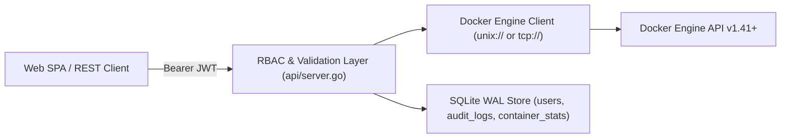

# Dockyard

Self-hosted Docker Engine & Compose management console with RBAC, live container telemetry, log streaming, and SQLite audit logging.

## Overview & Problem Statement

Managing containers across local or self-hosted Docker servers often means switching between `docker ps`, `docker stats`, `docker logs`, and ad-hoc SSH tunnels without role separation or an audit trail. Dockyard compiles to a single Go binary that communicates directly with the Docker Engine REST API over `/var/run/docker.sock` or `tcp://`, adds PBKDF2 + JWT RBAC (`admin`, `operator`, `viewer`), persists container CPU/RAM history and mutating action audit logs in SQLite, and serves an embedded web dashboard.

## Features

- **Container Lifecycle & Telemetry**: List, inspect, create/start, stop, restart, remove, live `CPU%` / `RAM%` SVG history charts, health status badges, and multiplexed log tailing / SSE streaming.
- **Image Management**: List images, inspect total disk usage and dangling count, pull new tags, re-tag repositories, and remove images.
- **Network & Volume Operations**: Inspect connected containers per network, create bridge/overlay/internal networks, and manage local Docker volumes.
- **Compose Stack Grouping**: Automatically groups containers sharing `com.docker.compose.project` labels with stack-level `start`, `stop`, and `restart` controls.
- **Security & RBAC**: First user becomes `admin` (subsequent registrations default to `viewer`), constant-time JWT verification, rate-limited auth endpoints, sensitive host bind-mount denylist (`/`, `/etc`, `/root`, `/var/run/docker.sock`), and SQLite `audit_logs`.

## Technology Stack

- **Backend**: Go 1.24 (`net/http`, Unix socket & TCP Docker Engine HTTP client, `crypto/pbkdf2`, HMAC-SHA256)
- **Database**: Embedded SQLite via `modernc.org/sqlite` (WAL mode, zero CGo)
- **Frontend**: Embedded vanilla HTML/CSS/JS SPA (`go:embed`)

## Quick Start

1. **Requirements**: Go 1.24+, running Docker Engine (`/var/run/docker.sock` or `DOCKER_HOST=tcp://...`)
2. **Clone**: `git clone https://github.com/fully-ai/dockyard.git && cd dockyard`
3. **Install / Build**: `./scripts/install.sh` (Windows: `.\scripts\install.ps1`)
4. **Configure**: Copy `.env.example` to `.env` and set `DOCKYARD_JWT_SECRET`
5. **Start**: `./scripts/dev.sh` (Windows: `.\scripts\dev.ps1`)
6. **Open**: `http://127.0.0.1:8091`
7. **Run Tests**: `./scripts/test.sh` (Windows: `.\scripts\test.ps1`)
8. **Stop**: `Ctrl+C` (or `docker compose down`)

## Configuration & Environment Variables

| Variable | Default | Description |
| --- | --- | --- |
| `DOCKYARD_ADDR` | `127.0.0.1:8091` | HTTP bind address |
| `DOCKYARD_DOCKER_HOST` | `unix:///var/run/docker.sock` | Docker Engine socket or TCP URI |
| `DOCKYARD_DATA_DIR` | `./data` | Directory holding `dockyard.db` |
| `DOCKYARD_JWT_SECRET` | random per boot | HMAC-SHA256 JWT signing secret |
| `DOCKYARD_ALLOW_SENSITIVE_MOUNTS` | `false` | Allow privileged containers or sensitive host bind paths |

## API Documentation

| Endpoint | Min Role | Description |
| --- | --- | --- |
| `GET /api/health` | Public | Liveness probe |
| `POST /api/auth/register` / `login` | Public | Register user or obtain Bearer JWT |
| `GET /api/system/info` | `viewer` | Docker Engine version, CPU/RAM & container counts |
| `GET /api/containers` / `POST /api/containers` | `viewer` / `admin` | List containers or create/start a container |
| `POST /api/containers/{id}/{start,stop,restart}` | `operator` | Container lifecycle control |
| `DELETE /api/containers/{id}` | `admin` | Remove container |
| `GET /api/containers/{id}/stats` | `viewer` | Live CPU/RAM sample + SQLite history |
| `GET /api/containers/{id}/logs` | `viewer` | Tail logs (`?stream=1` for SSE) |
| `GET /api/images`, `POST /api/images/pull`, `POST /api/images/{id}/tag`, `DELETE /api/images/{id}` | `viewer` / `operator` / `admin` | Image inventory & lifecycle |
| `GET/POST/DELETE /api/networks`, `/api/volumes` | `viewer` / `admin` | Network & volume CRUD |
| `GET /api/stacks`, `POST /api/stacks/{project}/{start,stop,restart}` | `viewer` / `operator` | Compose stack inspection & control |
| `GET /api/audit` | `viewer` | Audit trail of mutating operations |

## Architecture



## File Structure

```text
dockyard/
├── cmd/dockyard/main.go
├── internal/
│   ├── api/
│   │   ├── server.go
│   │   ├── server_test.go
│   │   └── index.html
│   ├── auth/auth.go
│   ├── docker/client.go
│   └── store/store.go
├── scripts/
├── docs/architecture.md
├── Dockerfile
└── compose.yaml
```

## Testing

Unit and integration tests spin up an in-process HTTP Docker Engine API test server and temporary SQLite database:

```bash
go vet ./...
go test -race -v ./...
```

## Docker Deployment

```bash
DOCKYARD_JWT_SECRET="replace-with-strong-secret" docker compose up --build -d
docker compose logs -f
docker compose down
```

> Note: Never bind port `8091` directly to a public interface without TLS and firewall rules, as Docker Engine access carries elevated host privileges.

## Security & Known Limitations

- Password hashing uses PBKDF2-HMAC-SHA256 (`120,000` iterations); tokens expire after 24 hours.
- Container `exec` interactive TTY shell streaming over WebSockets is not implemented in `v0.1.0` (lifecycle, stats, logs, inspect, images, networks, volumes, and Compose stacks are implemented).

## Contributing & License

See [CONTRIBUTING.md](CONTRIBUTING.md), [SECURITY.md](SECURITY.md), and [LICENSE](LICENSE) (Apache 2.0).
